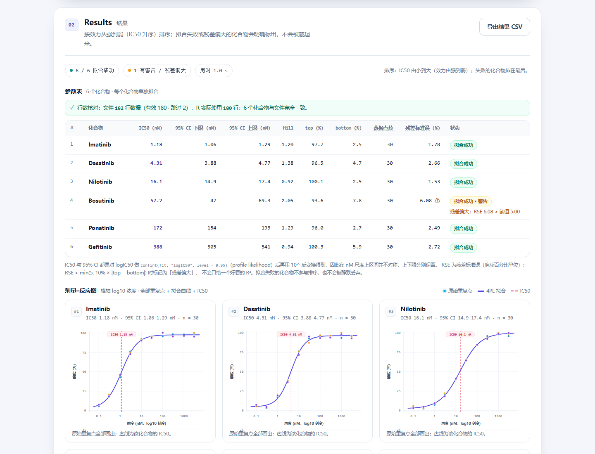

# Potency Ranker

**Browser-only 4PL dose–response fitting and potency ranking, powered by real R (webR).**

Upload a dose–response CSV and the app fits a separate four-parameter logistic (4PL) curve for every
compound with R's `nls()` running inside the browser, reports IC50 with its 95% profile-likelihood
confidence interval, the Hill slope, the top/bottom asymptotes and the residual standard error,
plots the raw replicates together with the fitted curve on a log10 concentration axis, and ranks the
compounds from most to least potent. Everything runs in the browser tab: no backend, no database, no
external API calls, and the data never leaves the machine.

## ① What the app is, who it is for, and what it answers

**What it is.** A single-page Vite application whose statistics are done by a genuine R process
compiled to WebAssembly. The uploaded CSV is passed to R as text, R fits one 4PL curve per compound
and returns the parameters, the profile-likelihood CI and the fitted curve. The page then renders the
parameter table, one dose–response chart per compound, the R code that was actually executed, and a
CSV export of the results.

**Who it is for.** Bench biochemists and pharmacologists comparing test compounds from a plate-based
assay, students learning how IC50 is estimated, and anyone who needs a defensible potency ranking
without installing R or GraphPad Prism — including teams whose dose–response data cannot be uploaded
to a third-party web tool.

**The question it answers.** *For each compound, at what concentration is the response half-maximal
(IC50), how uncertain is that number (95% CI), and which compound is the most potent?* It also shows
how well the curve actually describes the replicates (residual standard error and a warning when the
residuals are too large), so a ranking is never presented without its uncertainty.

## ② What biochemical research step this corresponds to

It automates the **potency-ranking step of a drug-screening campaign**: after a dose–response assay,
each hit is fitted with a 4PL curve and the compounds are ranked by IC50 — the same analysis normally
performed by hand in GraphPad Prism or an R script, here reproduced transparently in the browser
(with the exact R code printed on the page).

## ③ Screenshots

### Starting screen


*The page before any upload. The Data card holds the file picker (drag-and-drop or click), a data
self-check panel, the Run fit button and a "load sample data" shortcut; the Results card already
shows what will appear (parameter table, dose–response charts, R code).*

### Results screen



*After running the bundled demo data: the row-consistency check, the parameter table sorted by IC50
(including the 95% CI and a "residuals too large" warning), and one dose–response chart per compound
with raw replicate points, the fitted 4PL curve and the IC50 reference line. The R code panel and the
CSV export appear below.*

## Quick start

```bash
npm install
npm run dev
```

Open <http://localhost:5173>.

The R engine starts lazily on the first **Run fit** click (loading the WebAssembly build takes a few
seconds); the same R session is reused for later runs. A ready-to-upload demo file is included:
`data/sample-dose-response.csv` (6 compounds × 10 concentrations × 3 replicates, with two deliberately
incomplete rows), and the "load sample data" button uses the same data.

## Input format

UTF-8, comma-separated, header required. The four column names must match exactly (order is free):

```
compound,conc_nM,response_pct,replicate
A,0.3,4.1,1
A,3,6.2,1
A,30,49.3,1
A,1000,98.4,1
```

- `compound` — compound name
- `conc_nM` — concentration in nM, must be > 0 (it is log-transformed)
- `response_pct` — measured response in percent
- `replicate` — replicate index; several rows may share one concentration

Compounds, concentrations and values are never hard-coded in the application: the table, charts,
ranking and R program are all derived from the uploaded file. The bundled sample is only an input
for the demo button.

## Data checks

The moment a file is loaded, the **data self-check** shows: total data rows, number of compounds,
concentration levels and replicate count per compound, the observed concentration range (nM), and
the number of skipped rows split by reason (missing value / non-numeric / concentration ≤ 0) with
every skipped line number listed. Rows are never dropped silently.

After a fit, a **row-consistency banner** compares the file rows, the page parser and R itself:

- green: `file 182 rows (valid 180 · skipped 2), R used 180 rows; 6 compounds match the file`;
- red warning if R used a different number of rows or returned different compounds than the file.

## Output

- **Parameter table** — compound, IC50 (nM), 95% CI lower/upper, Hill slope, top, bottom, number of
  data points, residual standard error, status (success / warning / failure with the R error message).
  Sorted by IC50 ascending, i.e. strongest first; failed compounds are listed last.
- **Charts** — one per compound: log10 concentration axis labelled in nM, every raw replicate point
  (coloured by replicate), the fitted 4PL curve and a dashed vertical line at IC50. No bar charts and
  no truncated axes (the y axis always includes 0–100 % and all observations).
- **R code** — the exact program executed by webR, including the uploaded CSV, `read.csv(text = …)`,
  the `nls()` fit and the `confint()` call. Not a summary.
- **Export CSV** — the table plus a note column with warnings and failure reasons.

## Method

Each compound is fitted independently with

```
response = bottom + (top - bottom) / (1 + 10^((logIC50 - log10(conc)) * hill))
```

- the predictor is always `log10(conc)`;
- start values: `bottom = min(response)`, `top = max(response)`, `logIC50 = median(log10(conc))`,
  `hill = 1`;
- `nls()` is called with `algorithm = "port"` and deliberately wide bounds (bottom/top ±1e4,
  logIC50 ±30, hill ±50). The bounds never constrain a realistic estimate; they keep the fitting
  steps numerically stable so that the profile CI can be computed;
- the 95 % CI is `confint(fit, "logIC50", level = 0.95)` (profile likelihood), back-transformed to nM
  with `10^`; the interval is asymmetric on the nM scale and both endpoints are kept;
- the residual standard error (RSE, in percentage points) is reported; RSE above
  `min(5, 10 % × |top − bottom|)` is flagged as "residuals too large" in the table and on the chart;
- decreasing curves (response falling with concentration) are normalised after the fit by swapping
  top/bottom and reporting a negative Hill slope — the same curve, easier to read;
- an `nls()` error or non-convergence never crashes the page: that compound is reported as failed
  with R's message, and its raw points remain visible in the chart.

## Project structure

```
README.md                    project overview (this file)
PROMPTS.md                   placeholder (to be filled in)
EVALUATION.md                placeholder (to be filled in)
REFLECTION.md                placeholder (to be filled in)

screenshots/
  01_start.png               starting screen
  02_results.png             results screen

data/
  sample-dose-response.csv   ready-to-upload demo data

index.html                   page skeleton (Data / Results / empty states)
package.json                 scripts and dependencies (vite, webr)
vite.config.js               Vite config: port 5173, COOP/COEP, no pre-bundling of webR,
                             copies the webR runtime into public/webr at startup

src/
  main.js                    state, events, table/charts/R-code rendering, CSV export
  csv.js                     CSV parsing and data self-check
  consistency.js             file rows vs. rows used by R, plus the warning notice
  r-code.js                  builds the executed R program and parses R's output
  webr-engine.js             lazy webR initialisation and evalRRaw()
  plot.js                    hand-written SVG dose–response chart
  format.js                  number formatting
  sample.js                  demo dataset used by the "load sample data" button
  style.css                  styles

scripts/
  setup-webr.mjs             copies node_modules/webr/dist to public/webr
  generate-sample.mjs        regenerates data/sample-dose-response.csv and src/sample.js
  capture-screenshots.mjs    writes screenshots/01_start.png and screenshots/02_results.png
  windows-exec-guard.cjs     no-op outside restricted Windows environments
  test-csv.mjs               unit checks for CSV parsing and self-check
  test-consistency.mjs       unit checks for the row-consistency warning
  browser-check.mjs          end-to-end check in headless Chrome

public/webr/                 self-hosted webR runtime, generated at startup (gitignored)
```

## Development notes

- **Self-hosted R runtime.** `webr` normally downloads the R WebAssembly binaries from a CDN when it
  runs in a browser. `vite.config.js` copies `node_modules/webr/dist` into `public/webr/` before the
  server starts, and the page calls `new WebR({ baseUrl: '/webr/' })`, so no request leaves the local
  origin. The copy is skipped when the installed webr version is unchanged.
- **Install scripts disabled.** `.npmrc` sets `ignore-scripts=true` and keeps npm's cache inside the
  project (`.npm-cache/`). Nothing in this project needs install scripts (esbuild's binary comes from
  an optional dependency, and the webR runtime is copied by Vite), and some sandboxed environments
  reject npm's piped install scripts.
- **Dev command.** `npm run dev` runs Vite with `--configLoader native` and a small guard script that
  only changes behaviour when a restricted Windows environment refuses `exec("net use")`; on a normal
  machine it behaves like `vite --port 5173`.
- **Checks.** `node scripts/test-csv.mjs` and `node scripts/test-consistency.mjs` run without a
  browser. `node scripts/browser-check.mjs` needs a running dev server and Chrome/Edge and exercises
  upload, fitting, charts, R code, export, failure handling and the "no external request" guarantee.

## Limitations

- The 4PL model assumes a monotonic sigmoid; non-monotonic data will usually fail to converge and is
  reported as a failure rather than forced onto a curve.
- `nls()` is a local optimiser; unusual datasets can converge to a local minimum.
- Profile-likelihood confidence intervals can fail for some datasets (for example when the curve is
  under-determined); the CI is then shown as "—" with R's error message in the status column.
- Only single-compound, independent 4PL fits are supported (no global/shared fits or multi-parameter
  models).
